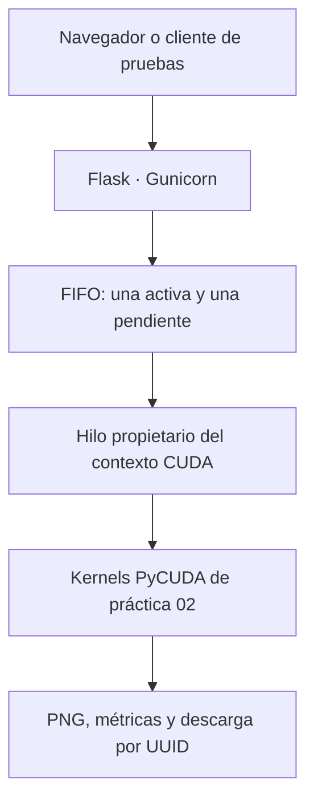

# Práctica 03 · Convolución web con PyCUDA y Docker

Continuación de la práctica 02 recibida en el ZIP. Conserva sus kernels y añade
una interfaz, API HTTP, atención FIFO, contenedor y herramientas reproducibles.
**Inicio recomendado: [GUIA_PRACTICA3.md](GUIA_PRACTICA3.md)**: cambios, pasos del
estudiante y pasos del profesor. El enunciado está en docs/Practica3_enunciado.pdf.



## Inicio rápido (CMD Windows, desde esta carpeta)

Necesita NVIDIA, controlador compatible y Docker Desktop con backend WSL2 y
contenedores Linux. Tener Python para los clientes; CUDA Toolkit/PyCUDA en el
host son opcionales si se documenta por qué no se midió directamente allí.

```bat
docker run --rm --gpus all nvidia/cuda:12.6.3-devel-ubuntu22.04 nvidia-smi
python -m tools.build --out evidence/build
docker run --rm --gpus all practica3:1.0 python -m tools.diagnose
docker run -d --name practica3 --gpus all -p 8000:8000 --mount "type=bind,source=%cd%\evidence,target=/app/evidence" practica3:1.0
```

Abrir http://localhost:8000. Para clientes, validación y experimentos consulte la
guía. La carpeta evidence se crea con tools.build. El build requiere Git limpio;
si descargó este ZIP, primero llévelo a su rama y haga un commit.

## API y herramientas

- [API.md](docs/API.md): rutas, campos, respuestas, errores, límites y limpieza.
- [ARQUITECTURA_Y_MEDICION.md](docs/ARQUITECTURA_Y_MEDICION.md): contexto, memoria y alcance de cada tiempo.
- [CUMPLIMIENTO.md](docs/CUMPLIMIENTO.md): requisito → archivo → evidencia pendiente.
- `python -m tools.prepare_data`: restaura los PGM exactos desde gzip; Docker lo hace al construir.
- `python -m tools.verify_sources`: integridad de código anterior e imágenes.
- `python -m pytest tests_web -q`: pruebas HTTP/cola con simulación explícita, sin evidencia de rendimiento.
- `python -m tools.validate_gpu --url http://localhost:8000 --out evidence/validation`: validación con GPU real.
- `python -m tools.direct --mode host_direct --out evidence/host`: ejecución directa anfitrión.
- `python -m tools.client --url http://localhost:8000 --out evidence/service --network-note "mismo equipo, loopback"`: todas las series HTTP.
- `python -m tools.summarize --evidence evidence --out evidence/summary`: CSV, medianas/IQR y gráficas.

## Compatibilidad fijada

Base `nvidia/cuda:12.6.3-devel-ubuntu22.04`, Python 3.10 provisto por Ubuntu,
PyCUDA 2024.1, NumPy 1.26.4, Flask 3.1.0 y Gunicorn 23.0.0. Ver requirements-web.txt.
Se registra la versión exacta instalada de Python/paquetes con pip freeze y la
identidad/digest de la imagen con tools.build/evidence. APT y dependencias
transitivas no constituyen un lock binario: conservar la imagen construida por ID.
Para reproducir exactamente use el mismo ID/digest, no solo la etiqueta local.
El paquete `devel` mantiene nvcc porque SourceModule compila al arrancar; no
instala un controlador NVIDIA dentro del contenedor. El anfitrión debe exponerlo.
Se fija como objetivo conservador controlador Linux >=560.35.05 / Windows >=561.17
para CUDA 12.6.3, en lugar de depender de compatibilidad menor restringida.

Referencias oficiales consultadas:
- https://docs.nvidia.com/cuda/archive/12.6.3/cuda-toolkit-release-notes/index.html
- https://docs.nvidia.com/datacenter/cloud-native/container-toolkit/latest/install-guide.html
- https://docs.docker.com/desktop/features/gpu/
- https://documen.tician.de/pycuda/driver.html
- https://flask.palletsprojects.com/en/stable/deploying/gunicorn/

## Trazabilidad y estado de entrega

`docs/origin_practica2.json` identifica el ZIP, commit local incluido, hashes de
fuentes e imágenes. `codigo_practica02.bundle` permite recuperar la referencia
anterior: `git clone codigo_practica02.bundle ../referencia_practica2`.
La URL pública del repo y autores/fuente de las fotos no fueron suministrados:
completar docs/project_metadata.json. No se inventó un commit de GitHub.

El código está preparado para las pruebas, **no se afirma que Docker/NVIDIA se
hayan ejecutado en el entorno de preparación**. Ver evidence/VERIFICACION_LOCAL.json.
Las mediciones reales de práctica 03, despliegue y firmas deben generarse en el
laboratorio o nube. El ZIP de origen no incluía la carpeta mediciones de la
campaña anterior; sus CSV/tablas/figuras recibidos se conservan en results y no
se usan como mediciones nuevas. No es necesario repetir las cuatro versiones de
práctica 02 para esta práctica.
